<p align="center">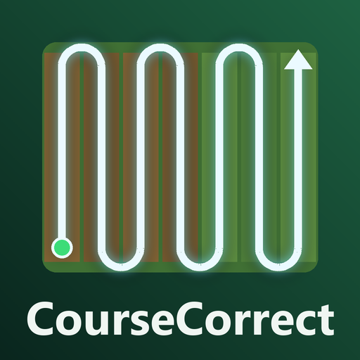</p>

# CourseCorrect (FS25_CourseCorrect)

A field-work helper for Farming Simulator 25: it plans a course for the field you are on (headlands, rows, turns)
and a hired helper drives it. Built from scratch as a modern, easier replacement for Courseplay, and made to work
with AutoDrive out of the box.

<table><tr><td align="center" valign="top">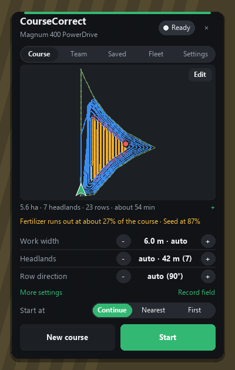<br><sub>Ready on a field</sub></td><td align="center" valign="top">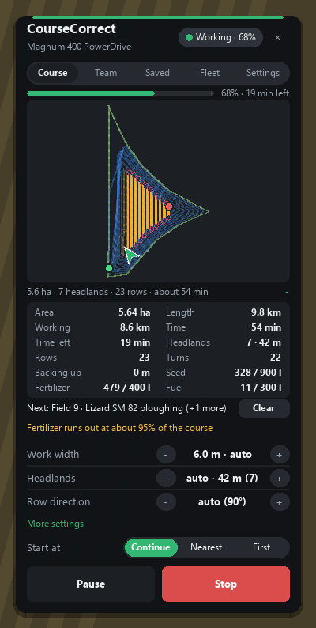<br><sub>Working, details open</sub></td><td align="center" valign="top">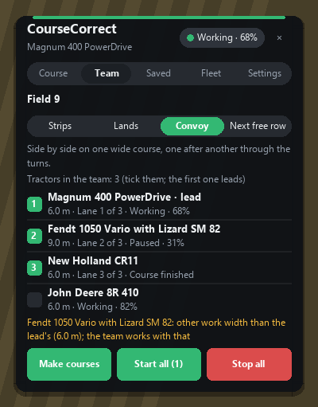<br><sub>Team tab</sub></td></tr></table>

*The pictures are drawn by the mod's own panel and course code outside the game (`tools/readme_images.py`), so they
show what this build does; in the game it looks the same, on the game's own picture behind it.*

| | |
|---|---|
| Version | **0.7.1.0** (called *Guidance* up to 0.4.4.0) |
| Author | Chris Fennell |
| Zip | `FS25_CourseCorrect.zip`: 41 files, 246,244 bytes |
| SHA-256 | `95d12b09a4945327642213a064ae987b2e620b8d1af51cfbec70ce579d2bb085` |
| Status | Pre-release: tested offline (see Testing), not yet in the game. Download the zip from the Releases page. |
| Multiplayer | Yes, including dedicated servers |
| Languages | English, German, French, Polish, Dutch, Spanish, Italian, Czech |
| Needs | Nothing. AutoDrive is optional. **Courseplay must not be loaded** if AutoDrive's CP button should start CourseCorrect (see below). |

## Renamed from Guidance (0.5.0.0)

The mod was called **Guidance** (`FS25_Guidance.zip`) up to 0.4.4.0. Everything players and admins see is now
CourseCorrect: the mod's name and icon, the panel, the helper's name, the key binding names, log lines
(`CourseCorrect: ...`), the console command (`ccDebug`) and its files. What Guidance saved is taken over by itself,
nothing has to be set up again:

| Saved by Guidance | Read by CourseCorrect from |
|---|---|
| tractors' settings, their course and progress (savegame `vehicles.xml`) | the old entries, once; saved under the new name from then on |
| saved courses, recorded / painted fields, field settings, work log, next-free-row progress (server) | `guidanceCourses.xml` in the savegame folder, until `courseCorrect.xml` is written at the next save |
| your defaults and the panel's place (your PC) | `modSettings/FS25_Guidance.xml`, until `modSettings/FS25_CourseCorrect.xml` is written |
| exported course files (your PC) | listed from both `modSettings/FS25_Guidance/courses` and `modSettings/FS25_CourseCorrect/courses` |
| key bindings | the same actions as before, kept |

**Only one of the two may be loaded.** With `FS25_Guidance.zip` still in the mods, CourseCorrect switches itself
off (and says so on the screen and in the log) and saves nothing, so no data is lost: remove `FS25_Guidance.zip`
(from the server's mods too) and start again.

---

## Alerts on the screen

A card for every helper of your farm that needs you, the worst first: stuck or out of fuel (red); full, needs
filling, next field waiting, giving way for more than 15 s, fuel low (amber); finished (green). Each card shows the
vehicle, what it needs and how long ago; **a click takes you into that vehicle** with the panel open; a finished
one can be closed with ×. Its top line counts how many need you and how many are working (with none needing you,
only that line, while helpers work). **Drag it by its top line** anywhere. *My defaults* → *Alerts on screen*
switches it off (and a click on the value puts it back in its first place); *Sound alerts* plays the game's
notification sound (its error sound for stuck / out of fuel) with each CourseCorrect notification.

<table><tr><td align="center" valign="top">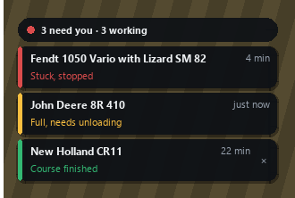<br><sub>Alerts: one stuck, one full, one finished</sub></td></tr></table>

## Keys

Panel size: Settings tab → *My defaults* → *Panel size* (70 to 150 %, click the value for 100 %).

**Controller**: CourseCorrect has three actions for using the panel without a mouse, *CourseCorrect: panel, next button*,
*previous button* and *press button*. They have no keys of their own (a controller's buttons are all taken by the
game); bind them in the game's controls, e.g. to the d-pad and a face button. A green frame shows which button is
picked; moving the mouse hides it.

| Key | Does |
|---|---|
| **Ctrl+J** | open / close the panel |
| **Alt+J** | start / stop the CourseCorrect helper |
| **H** (the game's) | starts the **game's own** helper, not CourseCorrect |

Both CourseCorrect keys can be changed in the game's controls. Until 0.3.0.2 they were Ctrl+G and Ctrl+H, which clash
with the game's *switch seat* and with Courseplay's keys; a player who changed them in the game keeps their own.

## Quick start

1. Get in a tractor with an implement and drive onto the field.
2. Press **Ctrl+J** to open the panel. The mouse cursor appears with it.
3. Click **Make course**. The course shows on the panel's map right away.
4. Change anything you like (work width, headlands, row direction...). The course is remade on every change.
5. Click **Start**. **Alt+J** starts and stops the helper without the panel.

Drag the panel anywhere by its background; it remembers where you put it.

---

## The panel

Five tabs: **Course**, **Team**, **Saved**, **Fleet** and **Settings**.

### Course

<table><tr><td align="center" valign="top"><br><sub>Before the start</sub></td><td align="center" valign="top">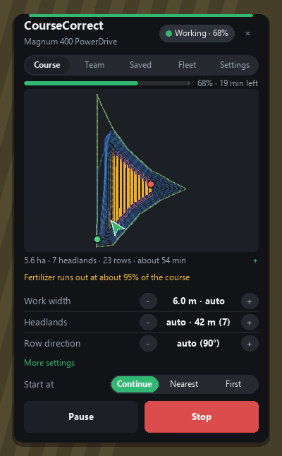<br><sub>Working</sub></td><td align="center" valign="top">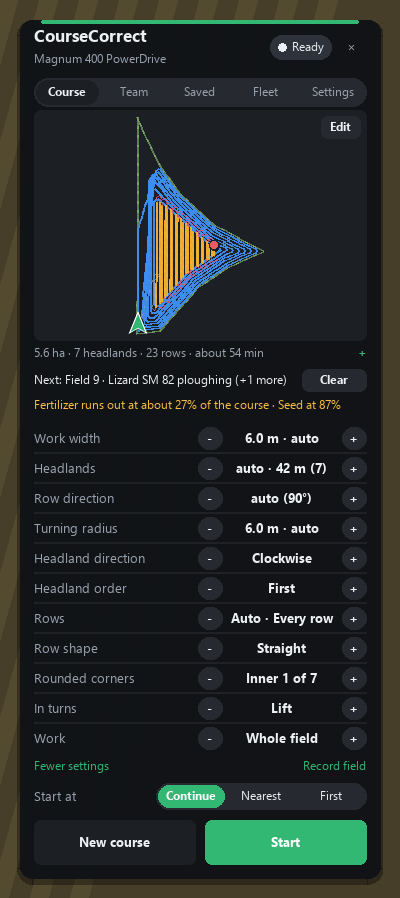<br><sub>More settings</sub></td></tr></table>

- **Progress bar**: the share of the course done and the time left, for example *70% · 19 min left*.
- **Course map**: headlands, rows, worked part, start (green) and end (red) markers and the tractor as a green
  arrow pointing where it heads. Slanted and upright lines are drawn in short pieces: on some screens (a window on
  an ultrawide monitor) the game turns overlays in a different pixel shape, and one long turned line came out too
  short, leaving gaps before the corners.
<table><tr><td align="center" valign="top">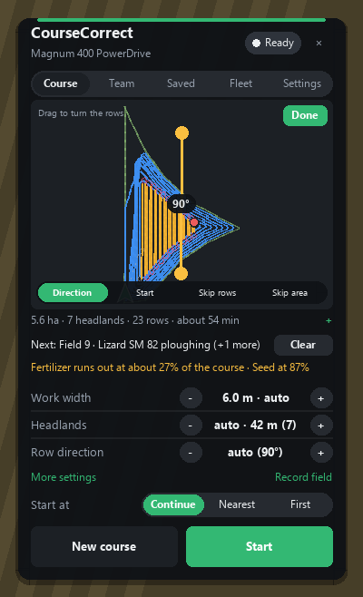<br><sub>Editor: drag to turn the rows</sub></td><td align="center" valign="top">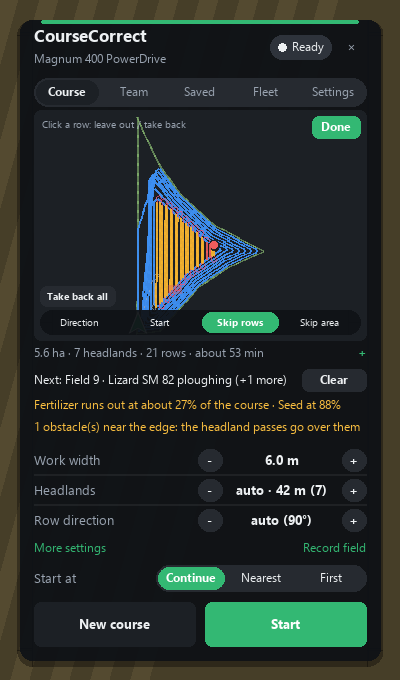<br><sub>Editor: rows left out (red), an area worked round</sub></td></tr></table>

- **Edit** (top right of the map): the **course editor**, right on the map. Five tools along its bottom:
  - *Direction*: drag to turn the rows (5° steps); the handle shows the angle.
  - *Start*: click where the course should start.
  - *Skip rows*: click a row to leave it out (it turns red), click it again to take it back.
  - *Skip area*: drag a box round anything to work round (a pile, a wet patch); it gets headland passes like an
    island.
  - *Move*: drag a point of the course somewhere else (round a pole, off a ditch); the course bends there, its
    neighbours within 8 m following less the further away. Moved points are ringed. Any other change of the course
    (width, direction...) or a new course drops them.

  Every change makes the course again at once; **Take back all** undoes the rows and areas left out and the moved
  points, **Done** closes
  the editor. Rows and areas left out belong to their field (a course on another field starts clean) and go over
  the network and into the savegame with the course.
- **Summary**: area, headlands, rows and estimated time. Click it to show the **details**:
  - length, worked length, time, time left
  - headland passes and their width, rows, turns, metres of reversing, islands
  - **planner rows**: seed, fertiliser (a seeder's fertiliser tank too), lime, spray, slurry / manure and fuel
    needed against what is in the tanks, each by the game's name of what is loaded ("bought by the helper" when the
    game's helper buys it). **With Precision Farming** on the server the seed and the fertiliser / lime are worked
    out its way, marked *(Precision Farming)*:
    - seed: the seed rate set on the seeder (low / medium / high), or in automatic the best rate for the soil at
      each spot of the course still to do (PF's own seed rate table);
    - fertiliser and lime: the amount set on the machine, or in automatic what each spot still needs (its nitrogen
      against what the crop wants on that soil, its pH against the soil's best), from PF's maps.

    That is automatic: used when Precision Farming is installed, not when it isn't. Settings → *My defaults* →
    **Precision Farming** shows which (*Auto (installed)* / *Auto (not installed)*) and switches it **Off** (the
    game's plain rates then, as without it).
- **Warnings**:
  - everything that will not last, the first first: "*Seed runs out at about 85% of the course · Fertilizer at
    60%*"
  - turns that could not be kept on the field
  - the next queued course, with a **Clear** button
  - another implement hitched than the course was made for: "*Made for: ... Other implement now*" with **Make
    again** (one click: the course made again for what is hitched now)
- **Settings rows** (− value +; clicking a value goes back to *auto*): work width, headlands, row direction.
  **More settings** adds turning radius, headland direction, headland order, rows pattern (and for *Lands* rows
  per land and the worked side), row shape, rounded corners, in turns and work part. Minimum headland, team and lower / raise timing are on the Settings tab.
- **Start at**: *Continue* (where it stopped), *Nearest* (the nearest worked stretch, facing the same way, even
  mid-row) or *First*. It can be changed while the helper works too (it counts at the next start); on a server
  it goes to the server, so a start from the game's own helper menu uses it as well.
- **Buttons**: *New course* + *Start*, or *Pause/Resume* + *Stop* while working.
- **Record field**: drive around a meadow, an odd corner or part of a field to make your own field outline
  (at least 40 m, a point every 2 m). It is saved on the server and can be used like a real field.
- **Painted fields** (field ground made bigger, smaller or new with the landscaping tools, e.g. *Free Terraforming
  and Painting*): *New course* reads the field from the ground where the tractor is, not only from the map's
  outline. When the ground is the map's field as it is, nothing changes. When it differs (painted on, painted away,
  or a field painted where the map has none), CourseCorrect keeps it as a field of its own, *Field 32 (as on the
  ground)* or *Painted field 1*, saved and shared like a recorded field, and makes the course on it: rows over the
  painted part, none where it was painted away, spots inside that are not field ground worked round as islands.
  Every *New course* reads it again, so painting more is picked up. Big fields are read coarser (every 3 to 8 m
  instead of 2 m, the edge still placed to a few cm), so even 200 ha takes about a second. The field ground of the map's other fields is
  never taken in (two fields touching stay apart).

  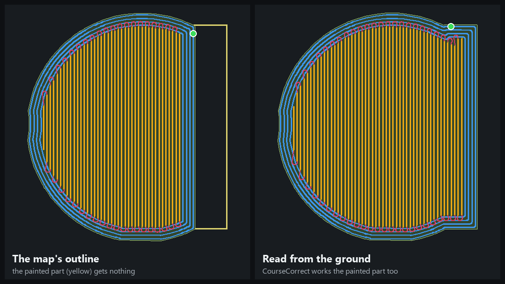

  <table><tr><td align="center" valign="top">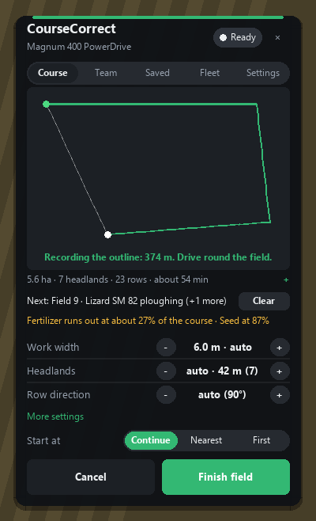<br><sub>Recording a field by driving round it</sub></td></tr></table>

### Saved

<table><tr><td align="center" valign="top">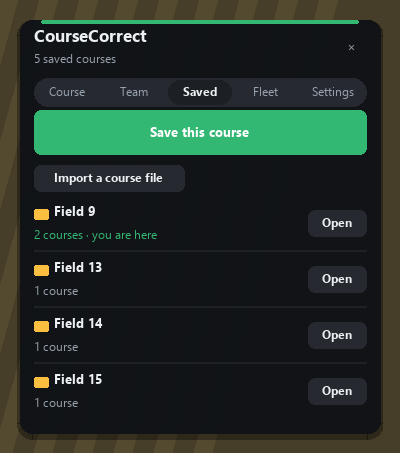<br><sub>A folder per field</sub></td><td align="center" valign="top">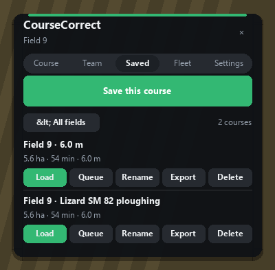<br><sub>Saved courses</sub></td><td align="center" valign="top">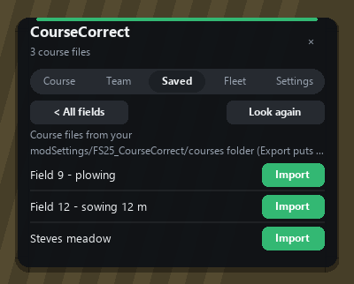<br><sub>Import a course file</sub></td></tr></table>

**Export** (each course) writes it to a file in your `modSettings/FS25_CourseCorrect/courses` folder, with its field's
outline. **Import a course file** (all-fields view) lists the files there; *Import* puts one into the saved courses.
On the same map it goes to its own field again; on another map or server (a friend's file) the outline is recorded
as a field of its own, so the course works there too.

Saved courses for the farm, **one folder per field** (made automatically). The folder of the field you are on
opens first. Each course has **Load**, **Queue**, **Rename** and **Delete**. A folder of a recorded field can be
deleted too. When you are on a field that has saved courses, the Course tab offers them.

### Fleet

<table><tr><td align="center" valign="top">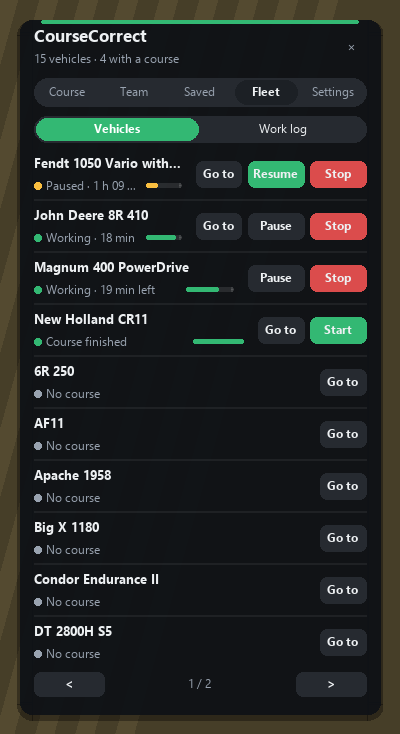<br><sub>Every vehicle, Go to</sub></td><td align="center" valign="top">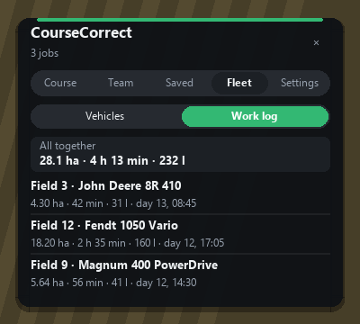<br><sub>Work log</sub></td></tr></table>

A switch at the top: **Vehicles** (below) or **Work log**: every helper job of your farm with field, tractor,
hectares, time, fuel and when (the game's day and time), newest first, with the totals of all of them. The server
keeps the last 300 jobs with the savegame.

Every vehicle of your farm: its status, progress, time left, and Pause/Resume/Stop (or Start) for each. The
subtitle counts them and how many have a course; working ones come first, then those with a course, then the rest,
10 to a page.

**Go to**: the button (or a click on the vehicle's name) puts you into that vehicle's driver's seat, the game's
own way of switching vehicles, and the panel opens again there on the same Fleet page. Not offered for the vehicle
you are in or one another player is sitting in.

### Settings

<table><tr><td align="center" valign="top">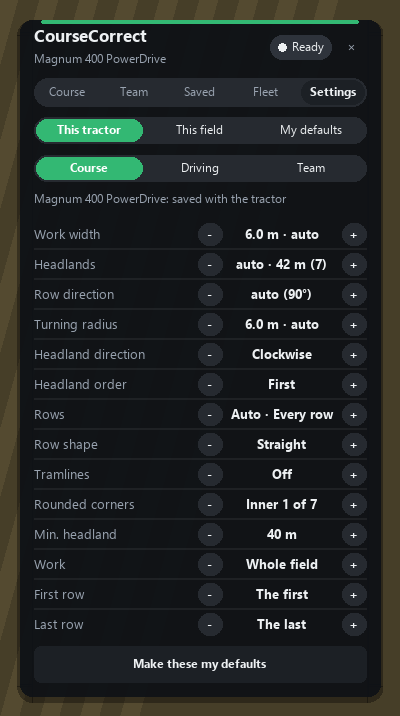<br><sub>This tractor</sub></td><td align="center" valign="top">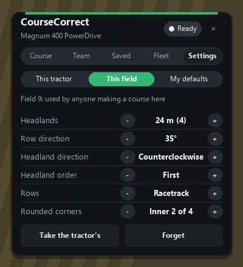<br><sub>This field</sub></td><td align="center" valign="top">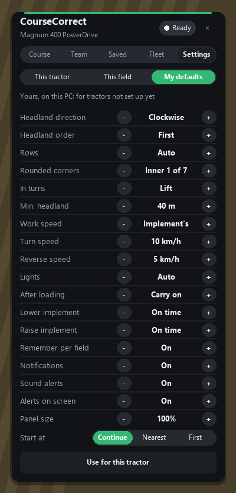<br><sub>My defaults</sub></td></tr></table>

Settings come at three levels. Switch between them at the top of the tab:

| Level | What it holds | Where it is kept | Who it applies to |
|---|---|---|---|
| **This tractor** (in three sections: *Course*, *Driving*, *Team*) | Everything: width, radius, headlands, row direction, pattern, rows per land, row shape, tramlines, corners, in turns, minimum headland, team, call unloader at (harvesters), tool offset, lower / raise timing, start at | In the savegame, with the vehicle | That tractor |
| **This field** | Headlands, row direction, headland direction, headland order, rows pattern, rounded corners | On the server, in the savegame (`courseCorrect.xml`) | **Anyone** who makes a course on that field |
| **My defaults** | Minimum headland, rounded corners, in turns, lower / raise timing, headland direction and order, pattern, start at, *Remember per field*, *Notifications*, *Debug overlay*, *Precision Farming* (Auto / Off), **Problem report** (writes `modSettings/FS25_CourseCorrect/report.txt` and shows its whole path) | On your own PC (`modSettings/FS25_CourseCorrect.xml`) | You only: tractors that are not set up yet |

How they combine when a course is made:

1. The tractor's settings are the starting point. A tractor that never had CourseCorrect settings gets **your
   defaults** the first time you open the panel in it.
2. If the field has **saved field settings**, they replace the tractor's for those six values.
3. An implement that works to one side (a mower) always forces the headland direction that keeps the tractor on
   the field.

The buttons on each level:

- *This tractor*: **Make these my defaults**.
- *This field*: **Take the tractor's** and **Forget**.
- *My defaults*: **Use for this tractor**, which sets all your defaults on the tractor at once and remakes the
  course once.

With **Remember per field** on (the default), changing any of the six field values on the Course tab also saves
it for that field. With it off, field settings change only from the Settings tab.

---

## Courses

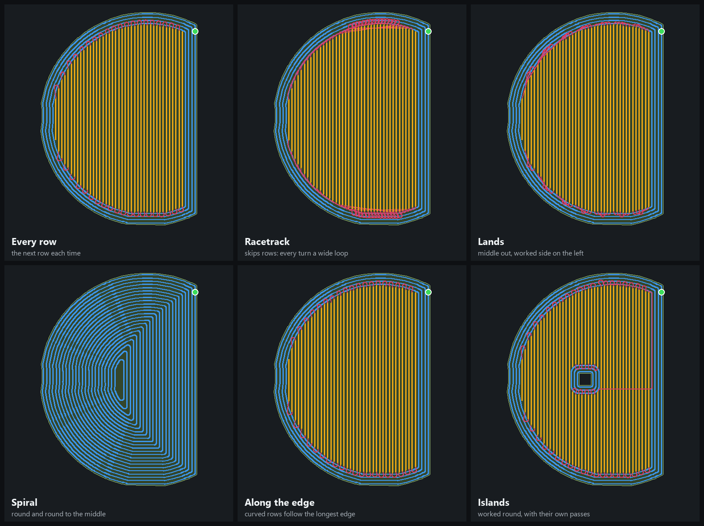

*Field 12 of SFCF Plains, 12 m wide: headlands blue, rows yellow, turns red, start green.*

- **Headlands**: *auto* gives at least the **minimum headland** (**40 m** by default since 0.4.4.0, changeable in
  5 m steps from 0 to 100 m) and always enough room to turn without leaving the field. The arrows add or remove a
  pass from there; the width is shown in metres with the pass count, for example *auto · 42 m (7)*. Tractors and
  your defaults still on the old 30 m default move to 40 m once; a course being worked keeps its headlands, and a
  minimum set by hand stays. If a turn still
  cannot stay on the field, auto adds passes (up to 15) and picks the smallest number that works.
- **Rows**: straight across the inside, evenly spaced. The direction is automatic (fewest turns) or set in 5°
  steps (or dragged in the editor).
- **Row shape**: *Straight*, or *Along the edge*: curved rows that follow the field's longest edge, each the same
  distance from the one before (for fields with a bent side, contour-like work). Bends are smoothed to what the
  tractor can follow.
- **Pattern**:
  - *Every row*: the next row each time, with three-point turns where there is no room to loop.
  - *Racetrack*: skips rows so turns are wide loops.
  - *Auto*: compares both and takes the faster one that stays on the field.
  - *Lands*: the rows in lands of *Rows per land* (2 to 30, default 6); each land is worked from its middle out,
    one side then the other, as for ploughing in lands. **Worked side** (*Auto*, *Left*, *Right*): the land grows
    so that the worked ground is always on that side of the vehicle. *Auto* is a harvester's pipe side (from where
    its pipe is), so the trailer or unloader beside it always drives on stubble, never in the crop.
  - *Spiral*: no rows: headland passes all the way in to the middle, round and round.
- **Tramlines** (Settings tab, *Course* section; for the sprayer or spreader): *On* puts the rows exactly on the
  passes of the field's sowing course, every k-th pass (k = this width over the seeder's), in its row direction, so
  the sprayer drives in the same tracks. The sowing course is the newest saved course on this field that is
  narrower, or another tractor's course on it; the setting shows which (e.g. *On Field 9 · sowing (3)*), or *No
  sowing course* when there is none (then ordinary rows).
- **Headland direction** (clockwise or counterclockwise) and **order** (headlands first or last).
- **Rounded corners** (*Inner N of M*): how many of the **innermost** headland passes get round corners (a smooth
  way into the rows); the outer ones get sharp corners so the corners get worked:
  - implement on the three-point hitch (can reverse): truly square, with a short reverse at each corner.
  - trailed implement (no reversing): the tightest bend the implement can follow while the tractor swings wide
    (about 0.6 × the drawbar length; on the outermost pass a bit rounder so the tractor stays on the field). A
    trailed implement can't make a truly square corner going forwards only. Its round corners are a smooth bend
    the tractor drives without swinging wide, clearly rounder than the sharp ones.
- **Work part of a field** (*Work*, also on the Course tab's More settings): *Whole field*, *Headlands only* or *Rows
  only*; and *First row* / *Last row* (Settings tab): only those rows, counted across the field from the side the
  rows start (e.g. finish rows 31 to 45 another tractor left).
- **Odd shapes**: a narrow tail sticking out of the field is left to the outer pass (no hairpin into it); a wedge cut
  into the field is followed round, not bridged.
- **Fields that split inside** (a deep notch or a wedge cut in): where the headland passes leave two parts,
  each part thick enough to turn in gets its own passes and rows (the main part first, then the others, outside
  in); a narrow tail stays with the outer passes.
- **Islands** (trees, ponds, poles in a field) get their own headland passes when they fit, and the turns keep
  clear of them.
- **Turns** stay on the field: the corners of the work area and the tractor's nose are checked along every turn
  and connection. Tested with implements up to 45 m wide (see Testing).
- **In turns**:
  - *Lift*: the normal way.
  - *Keep down, switch off*: on turns that stay clear of the field edge and obstacles, the implement stays down
    but is switched off, so no seed or spray is used and no time is lost lifting.
  - Plows and seeders that can't be switched off always lift.
- **Towed (trailed) implements**: the tractor swings wide in bends so the implement stays on the line, and the
  headland corners are sized so the implement doesn't cut them.
- **Side-offset implements** (mowers, offset plows such as the Lizard plows) work with their offset to the
  correct side.
- **The end**: the course runs on past the last row so the back of the implement finishes it.

## Grass: baling and loading after the rake

The rake's windrows lie on the passes of the rake's course. A tractor with a **baler**, a **loader / forage wagon** or
a pickup on a field where one of your tractors with a **rake** has a course gets a line on the Course tab:
"*Windrows: (rake tractor) raked here*" with **Follow**. That makes its course on the rake's passes: the same headland
passes, row direction and pattern as the rake's course got (a rake working in a team: the whole field), with its own
turning radius, speeds and timing. The baler's own stops (tying, dropping a bale) and a full loader wagon are handled
as with any implement. Mowing and raking are ordinary courses.

## Vineyards

Standing among vines (the game's vine system: grapes), *Make course* makes a field of the vineyard: all its rows that
belong together (plots side by side, rows in pieces end to end), with 15 m round them to turn in, named
"*Vineyard 1*"... The course drives along the rows, 2 m past the vines at each end, without headland passes. The next
row is the nearest one far enough to the side to turn into without backing up, the rows skipped on the way filled in
on the way back.

- **On the rows** (a grape harvester or a pre-pruner: automatic) or **between the rows** (anything else: a sprayer,
  mulcher). Course tab: *Vineyard*: *Auto* / *On the rows* / *Between the rows*.
- Between the rows a tool reaching one row each side (up to about twice the row spacing) drives every other gap;
  the outermost rows are always reached.
- The vine tools aren't the game's AI implements (its own helper can't work vineyards): CourseCorrect unfolds them,
  lowers them on their hitch and switches them on at each row, and raises and switches them off at its end.

## Helpers without a course: unloader, bale collector, silo compacter, loader

A tractor with no field implement (a trailer, a bale loader, or standing at a bunker silo) gets its own view on the
Course tab; a switch on top picks the job when it could do more than one (*Field work*, *Unloader*, *Bales*,
*Silo*). The panel shows what it is doing (*Waiting for a combine*, *Unloading the combine*, *On the road to
unload*...), with *Pause* and *Stop*.

<table><tr><td align="center" valign="top">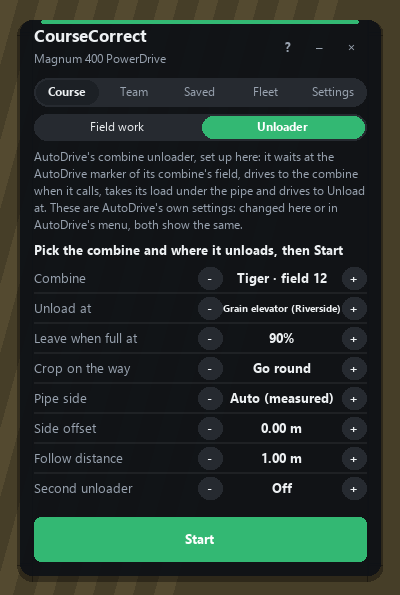<br><sub>Unloader</sub></td><td align="center" valign="top">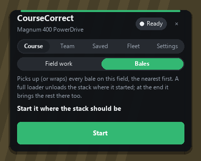<br><sub>Bale collector</sub></td><td align="center" valign="top">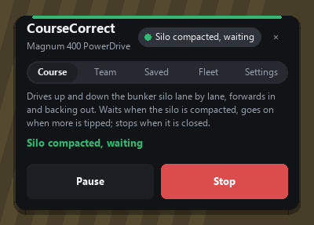<br><sub>Silo compacter, waiting</sub></td></tr></table>

- **Unloader** (a tractor with a trailer or an auger wagon), started at the field edge:
  - waits there until a combine of that field calls (CourseCorrect's combines at their *Call unloader at*, others
    at 80 %), the fullest first; two unloaders never serve the same combine;
  - drives to it round the standing crop, comes in from behind and keeps the trailer's opening under the pipe at
    the combine's speed; CourseCorrect's combine opens its pipe for it, holds on while it gets into place, never
    gives way to it (nor it to the combine), and waits for it when full instead of stopping;
  - stops following while the combine turns, and comes in again after;
  - **forage harvesters** call all the time they work: the trailer drives beside it on the side with no standing
    crop (the side picked as each row starts, kept along it), or straight behind it, the tractor clear of it, when
    there is crop on both sides (opening a field). CourseCorrect's forage harvester keeps its spout out and holds
    while nothing is under it (not in turns); the trailer, past its place or off its line beside a standing one,
    backs off 8 m and comes in again on the line;
  - *Leave when full at* (50 to 100 %, default 97): back to where it started, then **Unload at**:
    - an unloading station (sell point, silo) chosen in the panel: the game's own road driving takes it there, it
      tips, and comes back to the field edge to wait again;
    - **Truck at the field edge** (with an auger wagon): the nearest trailer standing on the field or within 20 m of
      it that takes the load; it drives alongside with the pipe towards it, opens the pipe, creeps until the pipe is
      over the trailer's opening, empties, and goes back to waiting. That truck full: the next one, or it stops full;
    - **Heap where it started** (with a tipper): tips out the back where it started, standing while the load runs
      out and rolling on slowly where the ground is full, so the heap gets long; the next load goes on where the
      last one ended;
    - *Stop when full*: it stops at the field edge (for you, or AutoDrive).
- **Bale collector** (a bale loader or a bale wrapper), started where the stack should be: picks up (or wraps)
  every bale of the field it is on, the nearest first, the grab point lined up and slow over the bale; a bale it
  missed is tried again from another side (three times). A full loader drives to where it started and unloads the
  stack, then goes on; at the end it brings the rest there too and finishes. Two collectors never go for the same
  bale. A **wrapper** goes only for the bales it can wrap (hay and silage, not straw) that aren't wrapped yet, wraps
  each where it lies and drops it; when it is done with bales left it can't wrap, the panel says so (*Done; bales left this wrapper can't wrap*). Started while a baler is still working the field (switched on, or a helper driving it), a wrapper or loader
  doesn't finish when it runs out of bales: it waits for the next (*Waiting for the baler*) and leaves alone any bale
  within 12 m of the baler (it may be dropping the next one there); it finishes once the baler is switched off and
  every bale is done.
- **Silo compacter**, started at (or on) a bunker silo: drives up and down it lane by lane (lanes as wide as the
  tractor or its roller), forwards in, backing out, 0.5 m from the walls; waits at 99 % compacted and goes on
  below 95 % (when more is tipped); finishes when the silo is no longer being filled.
- **Loader** (a wheel loader, telehandler or tractor front loader with a bucket), parked facing a heap: loads it into
  the trailers standing near it (within 80 m of where it started, standing still, with room for that material).
  Bucket flat and down, into the heap until full (or not getting on, or the heap ends on that lane); back out,
  carrying; square to the nearer side of the trailer; arm up over it (at least 3.5 m, 1 m over its opening);
  creeps in until the bucket is over the opening; tips; backs off. It digs one bucket's width at a time and moves
  over a lane when one is dug out. A trailer that stops taking it is full: the rest goes into the next one. Done
  when the heap is gone (*Done: the heap is gone*) or no trailer has room (*Stopped: no trailer with room*). The arm
  and bucket are moved through the game's own hydraulics on the server; which way each one goes is found out from
  its first moves (by watching the bucket's height and angle), so loaders of any make work the same.
- **Refill trips** (Settings tab, *Driving*: **Refill at**, for seeders and sprayers): when it runs empty (and the
  game's helper doesn't buy), it drives to the loading station you picked on the game's roads, fills there (each
  fill unit that takes what the station has), drives back to where it stopped, and goes on with the course from
  there. *Off*: it stops when empty, as before.

## Several tractors on one field (Team tab)

Open the **Team** tab (second tab) in any of the tractors:

1. **The field** is the one the tractor is on (or its course is on).
2. **Pick how they share it**: *Strips*, *Lands*, *Convoy* or *Next free row* (explained right under the
   switch).
3. **Tick the tractors** (your farm's vehicles; 2 to 6). The first one ticked **leads**: its settings make the
   field's layout for everybody (headlands, row direction, pattern, corners, work width); the widest turning radius
   and longest run-out of them all are used, so every tractor can drive every turn. Each tractor keeps its own
   driving preferences (in turns, lower/raise timing, tool offset, call unloader, start at). Each line shows its
   work width, its role (*Strip 2 of 3*, *Lane 1 of 3*, *Shares rows*) and what it is doing. A tractor whose work
   width differs from the lead's is named in a warning.
4. **Make courses** makes all their courses at once (the whole field is laid out once and shared).
5. **Start all** starts every member that isn't working; **Stop all** stops them.

The modes:

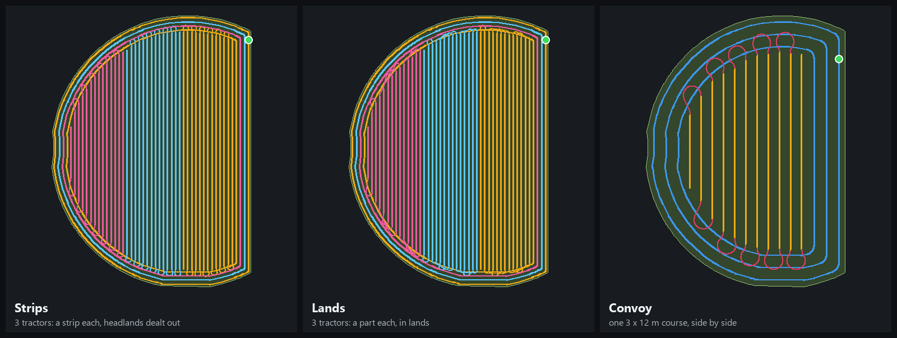

*Each tractor's share in its own colour (3 tractors, 12 m each).*

- **Strips**: the rows are cut into one strip per tractor, side by side across the field, an even share each, and
  each tractor gets the strip nearest to it; the headland passes are dealt out in turn (outer pass to the first,
  the next to the second, ...), island passes the same way.
- **Lands**: like strips (each tractor its own part, the nearest to it; headland passes dealt out), but each
  works its part in lands from the middle out, with the worked ground always on its pipe side (each harvester its
  own): the carts and unloaders drive on stubble, never in the crop. *Rows per land* and *Worked side* are on the
  Course tab's More settings.
- **Convoy**: one course as wide as all of them together (3 × 12 m = 36 m passes and rows); each drives its own
  lane of it side by side, the first on the left. Whoever reaches the course first leads; each keeps a gap (its
  width + 12 m) behind the one right ahead along the course, so they go through the turns one after another; the
  front one waits when one falls far behind (unloading, stuck). On the way to the course each drives its own way to
  the start of its lane. A convoy course turns forwards only, with round corners wide enough for the inside lane.
- **Next free row**: the headland passes are dealt out; the rows are shared as they go: a tractor finishing a row
  takes the nearest free one (preferring one far enough over to turn into without backing up), so a faster tractor
  simply does more rows and all finish together. No row is taken twice; rows a stopped tractor had taken are free
  again; what is done is kept with the savegame. Progress and time left are the team's (rows done of all).
- Each tractor's role can also be set by hand on the Settings tab (*Team on this field*, *Tractors in the team*,
  *This tractor*).

**Giving way** (always on, team or not): a CourseCorrect helper slows down and stops a few metres behind anything right
in its path, and goes on once it has moved off: another CourseCorrect helper, a vehicle a player drives, another mod's or
the game's helper, any vehicle moving, a person on foot. Not for parked vehicles (it would wait forever) and not for
AutoDrive's vehicles (they keep clear themselves, and an unloader drives right beside a combine). Side by side on
neighbouring passes isn't in the way (only implements that would overlap). Helpers never all wait for each other:
when waiting goes round in a circle (two or more), one goes first. A helper waiting more than 3 s shows *Giving
way*; the waiting doesn't count against the time estimate. Convoy partners don't give way to each other once both
are in their lanes (their spacing keeps them apart).

## Driving

- **Getting to the course**: a planned approach. With crop standing in the way, a pathfinder goes around it.
  Long connections are checked about 40 m ahead while working, because crop changes as you go.
- **Lowering and raising** happens where the implement's front and back reach the worked stretch. The helper
  waits until the implement is down before going on.
- **Lower / raise implement** (More settings): *On time*, or up to 5 m *early* or *late* in 0.5 m steps (− earlier,
  + later; click the value for *On time*). Lowering early makes sure the start of a row is worked; raising late
  makes sure its end is. These are tractor settings and can be part of *My defaults*.
- **Speeds** (Settings tab → This tractor → Driving; also in My defaults):
  - *Work speed*: the implement's limit, or at most what you set (3 to 40 km/h)
  - *Turn speed*: turns and connections, 10 km/h (4 to 25), slower in tight curves
  - *Reverse speed*: 5 km/h (2 to 10)
  The time estimate uses them.
- **Lights** (*Auto* / *Leave them*): with *Auto* the helper puts the lights on at night (the game's automatic work
  lights where the vehicle has them) and the beacons while it works, and puts them back as they were when it stops.
- **Pause / Resume** from the panel or the Fleet tab. The helper stops on the spot and keeps its place.
- **Tool offset** (Settings tab): *On centre*, or up to 3 m *left* / *right* in 0.1 m steps (click the value for
  *On centre*). CourseCorrect already measures an implement working to one side (mowers, plows) from its markers; the
  tool offset corrects on top of that: "0.5 m right" means the work lands 0.5 m right of where it should, so the
  helper steers 0.5 m left. It also counts for which way round a side-mounted mower has to go.
- **Call unloader at** (Settings tab, shown for combines, foragers and other harvesters with a pipe): 10 to 100 %
  in 5 % steps, default 80 %. When the helper starts, CourseCorrect sets AutoDrive's own *call level* on that
  harvester to it (AutoDrive's nearest step: 0, 10 ... 80, 85, 90, 100 %); AutoDrive then sends an unloader when
  the harvester is that full.
- **Combines and choppers**:
  - the pipe opens when needed
  - with AutoDrive unloaders around, the combine waits for them when full instead of stopping
  - it reports "maneuvering" in turns so unloaders keep clear, and holds when AutoDrive asks
- **Fill levels and fuel**: full, empty or out of fuel stops the helper and tells AutoDrive (see below).
- **Loading a save made while a helper worked**:
  - With *After loading: Carry on* (the default; Settings tab, also in *My defaults*) the helper starts again by
    itself about 8 s after loading, where it was. With *Wait* it waits for you to press Start (it then starts where
    *Start at* says).
  - The game sets its "helper active" flag again on load, but no helper comes with it. CourseCorrect ignores that leftover
    flag, so the panel stays usable, and the server clears it after about 3 s. The log then says
    `CourseCorrect: <tractor>: cleared a helper left over from the savegame`.
- **Another helper on the tractor** (the game's own field-work helper, started with its *hire helper* key **H**,
  or another mod's): the status shows *Other helper active* and a red **Stop helper** button takes the place of Start
  (on the Fleet tab too). The settings and *New course* stay usable; they are only locked while CourseCorrect itself
  drives. The game restarts its own helpers after loading a save, so a game helper left running comes back.
- **Started by the game**: a CourseCorrect job started the game's own way (hire-helper key, helper menu, the vehicle's
  last job) also starts where *Start at* says, not always at the first waypoint.
- **Stuck detection**: no progress for about 20 s ends the job with *stuck*.
- **Notifications** (in-game, only for your farm's vehicles; can be turned off in *My defaults*): finished,
  stuck, out of fuel, fuel low, needs unloading, needs filling, next field waiting.
- **Big map**: courses of your farm's vehicles are drawn on the in-game map.

### Time left

The estimate drives the course in a simulation the same way the helper does:

- work speed on worked stretches, turn speed in turns, 5 km/h reversing
- slowing for curves
- speeding up (0.8 m/s²) and braking (0.6 m/s²)
- a stop at every change of direction (about 4 s)
- a stop wherever the implement goes down (about 3 s), but no stop where it stays down through a turn

While the helper works, it then **learns that helper's real pace** against the estimate (after about 45 s of
driving) and scales the time left. Waiting to unload or refill, being paused or stuck doesn't count. In the
offline test of a 56-minute field the time left stayed within about 1.5 minutes of the real time left all the
way through.

### Queue (several fields in a row)

**Queue** saved courses from the Saved tab. When a course is finished, the helper loads the next one:

- **within 150 m** of its start: the helper drives there itself and starts.
- **farther away**: if an **AutoDrive marker** is within 250 m of the start, AutoDrive drives the tractor there,
  and CourseCorrect starts when AutoDrive stops.
- otherwise it shows *Next field waiting* until you drive it there.

The queue is saved with the vehicle.

---

## AutoDrive and the CP button

AutoDrive has built-in support for Courseplay: its **CP button** ("hand over to Courseplay") and its unload and
refill trips call a set of Courseplay functions on the vehicle. **CourseCorrect offers those same functions**, so
AutoDrive treats CourseCorrect as if it were Courseplay. No change to AutoDrive is needed.

**What works:**

- **AutoDrive's CP button starts and stops CourseCorrect** on the vehicle's course (`cpStartStopDriver`).
- **AutoDrive drives to the field and starts CourseCorrect** (`startCpAtFirstWp`).
- **Unload and refill trips**:
  1. When the trailer is full, the hopper empty or the fuel out, CourseCorrect stops and raises the matching
     Courseplay event (`onCpFull`, `onCpEmpty`, `onCpFuelEmpty`; also `onCpFinished`, `onCpBroken`).
  2. AutoDrive takes the vehicle away and brings it back.
  3. AutoDrive restarts CourseCorrect where it stopped (`startCpAtLastWp`), so nothing is missed:
     - in a row: at the start of that row if it is within 150 m, otherwise about 10 m back
     - on a headland pass: about 10 m back
     - in a turn: at the next row
- **AutoDrive's status display** shows CourseCorrect's statuses (`getIsCpActive`, `getCpActiveInfoTexts`). Statuses
  AutoDrive doesn't know (finished, next field waiting) are left out.
- **AutoDrive unloaders for a CourseCorrect combine** use `getIsCpHarvesterWaitingForUnload`,
  `getIsCpHarvesterManeuvering` and `holdCpHarvesterTemporarily`. `getIsCpHarvesterWaitingForUnloadInPocket`
  is always false: CourseCorrect doesn't back into a pocket.
- **The queue** uses AutoDrive the other way round: CourseCorrect asks AutoDrive to drive to the marker nearest the
  next field.

**Important: only without Courseplay.** Courseplay registers the same functions, and only one mod may do so.
CourseCorrect offers them **only when `FS25_Courseplay` is not loaded**. With Courseplay installed, AutoDrive's CP
button keeps starting Courseplay, and CourseCorrect works on its own (panel, Alt+J). The game log shows which is
active:

```
CourseCorrect: 0.5.0.0 loaded, AutoDrive interface on
```

With Courseplay loaded it says `AutoDrive interface off (Courseplay is installed)`. To switch to CourseCorrect,
remove Courseplay from the server's mods and restart the server.

---

## Multiplayer

- **Where things happen**:
  - courses are made on the player's machine
  - the helper drives on the server
  - only the plan (the settings a course is made from) is sent over the network and saved
  - every machine rebuilds the exact same course from that plan
- **Synced**:
  - course plans
  - progress
  - status
  - pause
  - the queue
  - saved courses
  - recorded fields
  - field settings
- **Joining**: a player who joins gets the saved courses, recorded fields and field settings from the server.
- **Server-side changes**: anything the helper does (driving, unloading, AutoDrive) only changes once the
  server has the new zip and has been restarted. Client and server must have the **same zip** (same SHA-256) or
  players can't join.

## Files CourseCorrect writes

| File | Where | What |
|---|---|---|
| `courseCorrect.xml` | savegame folder (server) | saved courses, recorded field outlines, field settings |
| `vehicles.xml` (CourseCorrect part) | savegame folder (server) | per tractor: settings, current course plan, progress, queue |
| `modSettings/FS25_CourseCorrect.xml` | each player's own game folder | My defaults and the panel position |

---

## Testing done for this build (offline)

The game has no test mode, so the mod's own Lua code is run outside the game (Python `lupa`, real Lua 5.1) with
small stand-ins for the engine, on the fields of the server's map (SFCF Plains). On GitHub the same tests run on
made-up fields (`tools/fixtures/test_fields.json`): a D, an L, a wedge cut in, a jagged edge, a long strip, a small
square... They found, and this build fixes: a field whose inside splits at a deep notch only got rows in one part
(now every part thick enough to turn in gets passes and rows, with ways between the parts kept on the field); the
spiral could end on a sliver; an obstacle could be dropped by adding headland passes (now the passes that keep it
worked round are preferred, and one that can't be worked round is shown); next free row on a small field could
hand out finished rows again.

| Test | What it checks | Result |
|---|---|---|
| `tools/smoke_test.py` | full drive of field 9 (56 min, 37 lowerings): finished, AutoDrive events, keep-down turns, pause, start at nearest, towed implement, standing crop (pathfinder), stuck, full tank + AutoDrive restart point | **8/8 OK** |
| `tools/smoke_test.py` | time left vs the real remaining time, every 5 min | within about 90 s |
| `tools/smoke_test.py` | implements down 3 m early / up 3 m late, and the other way round: same number of lowerings, at the shifted places | ±3.0 m, OK |
| `tools/scopes_test.py` | field settings over the network and in the savegame, a course taking the field's settings, *Remember per field*, *Use for this tractor*, minimum headland 30 m / 60 m, a save loaded with a leftover helper flag, a job started by the game with *Start at: Continue*, stopping the game's own helper from the panel; the old name: Guidance's server file, a tractor's settings saved under it and your old defaults read, switched off beside the old mod | **13/13 OK** |
| `tools/team_test.py` | 5 fields × teams of 2/3 at 6/12/24 m, strips and lands: every row and headland pass worked by exactly one tractor, together the whole field, no turn off the field; giving way: slows, stops, ignores helpers beside or behind, never both waiting | **all OK** |
| `tools/batch2_test.py` | headlands only / rows only / rows 5-10, turn and work speeds kept in a drive, lights on at night and back after, the work log entry (and over the network), export and import (same map: its field; other map: recorded) | **12/12 OK** |
| `tools/batch3_test.py` | lands (6-row lands, middle out, every row once; worked side left / right: in every land the rows done before always on that side, 75 looks each, none wrong), spiral (passes to the middle, no rows), curved rows along the edge, tramlines (an 18 m sprayer on a 6 m sowing course: every row on a sowing pass, the middle of each 3), rows left out (gone, listed for the editor), an area worked round (no waypoint in it); each on the field (worst 0.52 m) and lands / spiral / curved driven to the end (pinned to 30 m headlands: with 40 m field 9's inside no longer reaches its bent edge) | **14/14 OK** |
| `tools/fieldscan_test.py` | painted field ground: the map's field as it is (map outline kept, scan 0.05 s), painted on (80 m strip: its own field, area right within 3 %, rows over 96 % of the new part), the same again (no new field), painted more (same field, bigger), painted away (area right, no waypoint there), a spot inside not field (island, no waypoint on it), a field painted where the map has none, no field ground (map field as before), a player on a server (the field goes to the server first, the course follows) | **9/9 OK** |
| `tools/planner_test.py` | seed and the seeder's fertiliser by the game's rates; everything that runs out, the first first; with Precision Farming (its real PrecisionFarming.xml, stand-in maps): seed rate set high, seed by soil, fertiliser by need and set, lime by need, switched off in My defaults (the plain amounts), the part still to do, worked out at most every 2 s | **11/11 OK** |
| `tools/helpers_test.py` | the helpers without a course, through the mod's own drive loop: unloader (a combine harvesting field 9's rows, turning at each end; grain only flows under the pipe): comes, follows under the pipe, takes a full load, back to where it started, stops full; forage harvester (no tank, it holds while nothing is under its spout): beside it, and behind it with crop on both sides (the tractor never nearer than 8.9 m), the trailer filled; auger wagon into a truck 8 m off the field edge (pipe over the opening within 0.4 m, emptied, pipe in, waiting again); heap (two loads, the second going on 0.5 m from where the first ended, rear tip side); bale collector: all 6 bales with a 4-bale loader, the stacks unloaded where it started; bale wrapper: every hay bale wrapped, the straw bale left, that shown when done; bale wrapper behind a baler still at work: each bale wrapped as it is dropped, waiting for the next (59 s), finished only once the baler is switched off (closest 7 m centre to centre); silo compacter: every lane of a 12 m silo, never over the walls, waits when compacted, finishes when closed; refill trip: to the station, filled at the trigger, back, the course on; loader (arm and bucket wired the other way round, it has to learn them): a 16.2 t heap into a 20 t trailer, all of it in 9 min, nothing spilled, done when the heap is gone; a 6 t trailer filled, then stops | **12/12 OK** (unloader: 19.4 t, under the pipe 85 % of its following; forage harvester held 34 % of the time, mostly while the trailer came round after its turns) |
| `tools/support_test.py` | the editor's moved points (there, neighbours following less, over the network, dropped by another change, not on a new course), the problem report (version, vehicle, settings, the mod's last log lines; written through the game's file functions), the debug overlay (a helper's way, target and text); the grass chain (a baler with a 9 m turning radius on a 6 m rake's course: the same 5 rows, row ends 0.00 m apart, the same headland passes); *Start at* sent to the server without making the course again or losing where it got to, kept through a later course change | **11/11 OK** |
| `tools/vines_test.py` | a made-up vineyard (14 rows 2.8 m apart in two plots, one in pieces; another vineyard apart): read as 14 rows, made into a field; a grape harvester drives every row once, on it, 2 m past the vines, never off the vineyard, never into the row beside (all turns round); a 5.6 m sprayer between the rows, every other gap, every row sprayed; the vine tool unfolded, lowered, on, then up and off | **5/5 OK** |
| `tools/check_translations.py` | every language (8) has exactly English's 348 texts, the same placeholders, the names kept | **OK** |
| `tools/team_drive_test.py` | a whole team driving at the same time, every mode (lands too: field 9 × 3 in 21 min against 53 alone), against one tractor alone: field 9 × 3 tractors, field 12 × 2, field 27 × 4 | all finish; 99 %+ of the field worked on fields 12 and 27 (field 9: the same as alone); every next-free-row row done exactly once; closest two tractors came 4.4 m; 3 tractors about 2.6× as fast as one |
| `tools/pathfinder_test.py` | ways around standing crop, then driven, 8 fields (with 40 m headlands field 2's way came in along its row from the far end and turned back on the spot, 13 m off when driven: now a proper turn into the row, 0.4 m) | **8/8 OK** |
| `tools/envelope_test.py` | every turn and connection stays on the field (the work area's corners and both front corners of the tractor): 36 fields × 6/12/24/45 m × mounted/towed (288 courses), plus the Lizard plows (22 m / 26 m) | **360/360**, worst 0.55 m |
| `tools/hud_preview.py` | renders every panel view to PNG to check the layout | checked |
| `tools/readme_images.py` | draws this README's pictures (`docs/images`): every panel view, the patterns, a team's shares, a painted field, the icon | drawn for 0.5.0.0 |

**Not yet tested in the game:** waiting for the baler (0.7.1.0); the loader, vineyards, balers following the rake, *Start at* in multiplayer (0.7.0.0);
forage harvester chasing, overloading into a truck, tipping a heap, the bale
wrapper, moving points in the editor, the debug overlay, the problem report and the Precision Farming switch
(0.6.1.0); the unloader, bale collector, silo compacter, refill trips, the implement check and the new languages
(0.6.0.0); the rename and taking over Guidance's saved data (0.5.0.0); painted fields, the Lands team and worked side, Precision Farming figures (its
maps are read the way other mods read them; the seed rate set on a PF seeder is looked for under a few likely names,
else its automatic rate by soil is used) (0.4.4.0); the course editor, the lands / spiral / curved patterns and
tramlines (0.4.3.0), the Settings tab, the new time estimate and the field settings in multiplayer.
These are offline-tested only.

## Not in this build yet

- orchards (olives): not checked whether the game keeps them on the vine system; only vineyards are tested
- the loader doesn't load into a mixer wagon or a belt / conveyor, and doesn't push a heap together
- obstacles inside the headland band (a tree or pole within the headland passes' reach of the edge) aren't worked
  round: the passes go over them; the Course tab warns "*N obstacle(s) near the edge*". Islands further in are
  worked round.
- teams on a very small field (three tractors on a field of a handful of rows): where their ways cross they can get
  in each other's way (one stops, stuck); use fewer tractors there. On fields of usual size all modes are tested
  (see Testing).

---

## For developers

- **Lua 5.1**, the game's own API only. Clean-room: no Courseplay code was copied (Courseplay is GPL-3.0); other
  mods were only read to learn the FS25 API.
- **Layout**:
  - `scripts/Guidance.lua`: mod entry, save hooks, notifications
  - `scripts/Prefs.lua`: player defaults
  - `scripts/GuidanceVehicle.lua`: vehicle specialization, AutoDrive interface, queue, time left
  - `scripts/geometry/`: polygons, Dubins curves
  - `scripts/course/`: course generator, plan/course, library, field scan (painted field ground)
  - `scripts/ai/`: driver, path follower, pathfinder, planner, vehicle info, AI job
  - `scripts/events/`: network events
  - `scripts/gui/`: panel, drawing, big map
- **Build**: `python tools/build.py` writes `dist/FS25_CourseCorrect.zip` and checks the GIANTS rules: at most 128
  files, Lua files at most 0.5 MB, only known file types. `README.md`, `docs/`, `tools/` and `dist/` are not
  packed.
- **README pictures**: `python tools/readme_images.py ../FS25_SFCF_Plains/map/map.i3d` draws them again into
  `docs/images` (not packed into the mod).
- **Tests**: see the table above. Run them with the map's `map.i3d` path, for example:

  ```
  python tools/smoke_test.py ../FS25_SFCF_Plains/map/map.i3d
  ```

- **On GitHub**: every push runs `.github/workflows/tests.yml`: the translations checked, the zip built (kept as a
  download of the run) and the offline tests on made-up fields (`tools/fixtures/test_fields.json`, made by
  `tools/make_test_fields.py`; no map's data in the repo). Pushing a version tag (`v0.6.0.0`, the same as
  modDesc's version) runs `.github/workflows/release.yml`: the zip built and published as a release (0.x as a
  pre-release).
- **Translations**: `tools/check_translations.py` (also run by the build) checks every language has exactly
  English's keys and the same placeholders.
- **Licence**: MIT (`LICENSE`, not packed into the mod).
- **Releases**: each version is a GitHub release with `FS25_CourseCorrect.zip` attached. The zip is never renamed
  (no version in its name): the game knows a mod, and its saved data, by the zip's name.
- **On a server**: every player and the server need the very same zip; the server loads a new one only after a
  restart.
